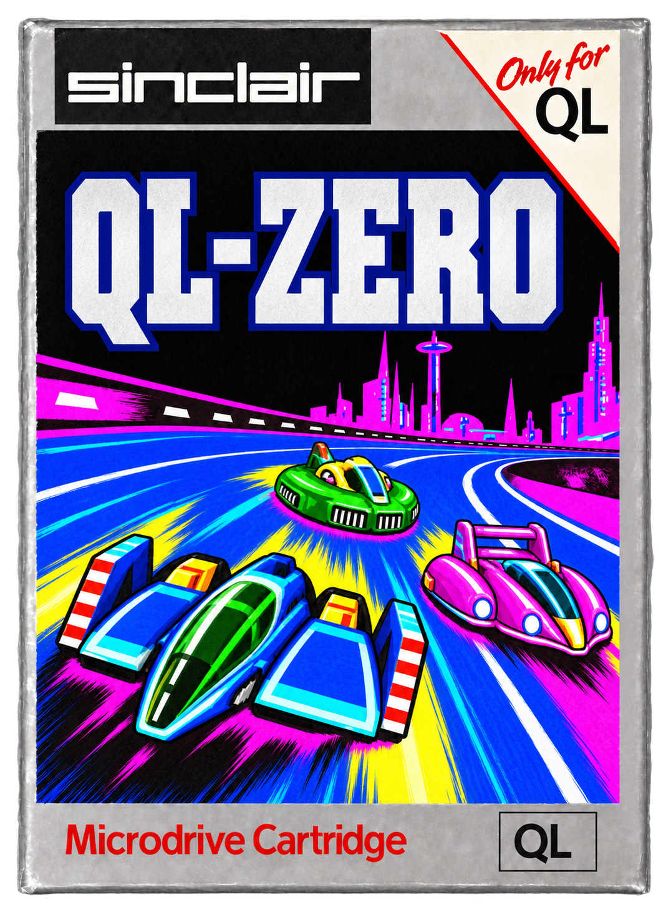
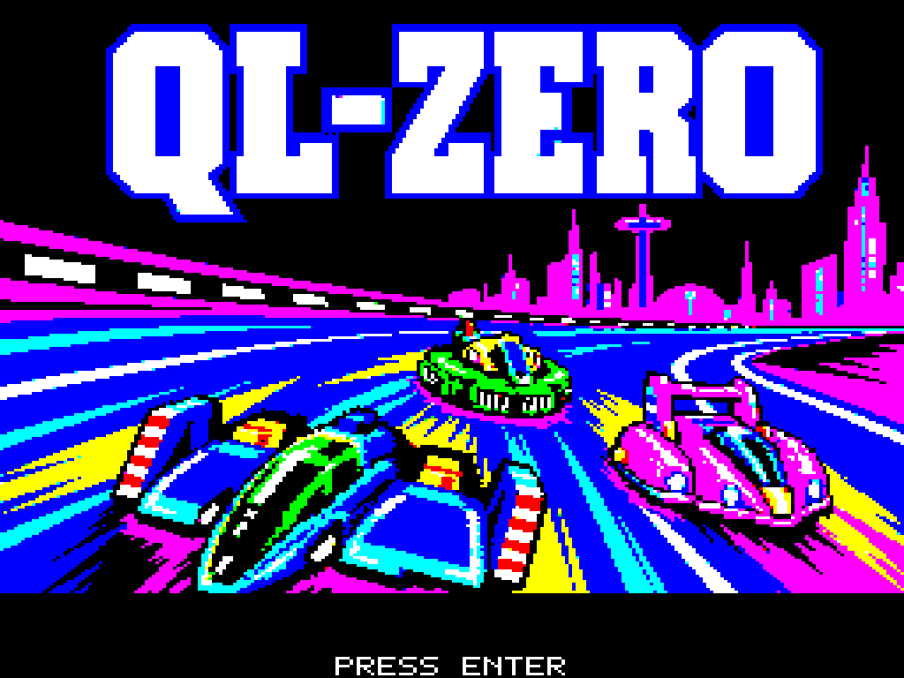

<a id="francais"></a>
# QL-Zero — v1.0

[English version](#english)

Un jeu de course futuriste pour le **Sinclair QL 128 Ko**, inspiré de F-Zero et F-Zero X. Pilotez un aéroglisseur, gérez votre énergie, utilisez le boost et affrontez deux adversaires sur une coupe de six circuits.



Développé avec l'aide de Chat GPT 6.1 Sol, en s'appuyant sur [NanoQL](https://github.com/pR-0000/NanoQL), pour la game jam [Retro Programmers United for Obscure Systems — Sinclair QL, édition 2026](https://itch.io/jam/rpufos-sinclair-ql). Le jeu fonctionne également sur un QL réel ; aucune extension mémoire ni accélération propre à NanoQL n'est nécessaire.

## Vidéo

[](media/QL-Zero.mp4)

**[Lire ou télécharger QL-Zero.mp4](media/QL-Zero.mp4)**

## Contenu du jeu

| Élément | Contenu de la v1 |
| --- | --- |
| Modes | **4** : GP Race, Time Attack, Practice et Death Race |
| Circuits | **6** : Mute City, Red Canyon, Big Blue, Sector Alpha, Sand Ocean et Silence |
| Coupe | **1 Classic Cup**, réunissant les six circuits, trois tours par course |
| Musiques | **8** : six thèmes de circuits, un thème de menu et un thème de cérémonie |
| Adversaires | **2 pilotes IA/CPU**, soit trois vaisseaux en course avec le joueur |
| Difficultés GP | **4** : Novice, Standard, Expert et Master |
| Graphismes | MODE 8, **256 × 256 pixels**, huit couleurs de base |
| Sauvegardes | Records et meilleurs fantômes Time Attack sur Microdrive inscriptible |
| Outils | Éditeur Python de circuits, de relief et de graphismes, avec aperçu et caméra libre |

- **GP Race** : gagnez la coupe aux points. Chaque arrivée rapporte 10, 7 ou 5 points ; un vaisseau détruit ne marque aucun point et passe à la course suivante. Le classement influence la grille suivante. La victoire déclenche un défilé et une remise des prix de 34 secondes.
- **Time Attack** : trois tours en solo, chronos par tour et fantôme de la meilleure course complète. F4 affiche ou masque le fantôme, son point cyan sur la mini-carte et l'alerte CHECK lorsqu'il approche par l'arrière.
- **Practice** : entraînement libre, sans adversaire et avec énergie illimitée.
- **Death Race** : détruisez les deux adversaires le plus rapidement possible. Le temps écoulé constitue le score. Les destructions rapportent aussi des étoiles dans les tableaux GP.

Le boost est disponible à partir du deuxième tour. Il consomme de l'énergie et s'arrête avant de vider entièrement la jauge ; les collisions peuvent toutefois achever le vaisseau. Les bandes roses rechargent l'énergie. L'attaque tournoyante protège temporairement le joueur, inflige des dégâts et conserve son inertie, tout en bloquant la direction et le boost.

## Jouer

Les fichiers prêts à l'emploi sont dans **[release/v1.0.0](release/v1.0.0)**.

1. Montez `qlzero_classic_cup.mdv` dans **MDV1** ou transférez les fichiers sur un Microdrive QL.
2. Démarrez avec cette cartouche, ou lancez `LRUN mdv1_BOOT` sous QDOS.
3. Attendez l'écran titre, puis appuyez sur Entrée pour ouvrir le menu.

La cartouche distribuée contient des records vierges. Autorisez l'écriture pour conserver vos chronos et fantômes. Faites une copie de votre cartouche personnelle avant de la remplacer par une nouvelle version.

| Commande | Action |
| --- | --- |
| Menu : gauche/droite | Choisir le mode |
| Menu : haut/bas | Choisir le circuit ou la difficulté |
| Menu : Entrée / CTRL | Valider / consulter les records |
| Haut / bas | Accélérer / freiner |
| Gauche / droite | Diriger le vaisseau |
| Espace | Boost, à partir du deuxième tour |
| CTRL | Attaque tournoyante |
| **F2** | **Couper ou réactiver la musique en course** |
| **F4** | Afficher/masquer le fantôme en Time Attack |
| Échap | Pause : **RESUME** ou **QUIT** |

La cérémonie de victoire se déroule entièrement : aucune touche ne peut la passer. Une nouvelle pression après sa fin permet de quitter le classement.

Sur NanoQL, l'injection directe utilise `cup_nanoql.bin` : **Load/PC = 0x30000**, **SSP = 0x3fff0**. La même cartouche doit rester montée dans MDV1, car les circuits sont chargés entre les courses. L'injection ouvre directement le menu. Consultez le [guide de jeu](docs/PLAYING.md) pour les détails matériels.

## Compiler et modifier

Le moteur est écrit en assembleur Motorola 68000 compatible **68008**. Les outils Python génèrent les ressources et l'image Microdrive.

```text
python -m pip install -r requirements.txt
python tools/build_cup.py
python tools/circuit_editor.py
python -m unittest discover -s tests -v
```

La compilation nécessite également **vasm** et le constructeur Microdrive de NanoQL, configurés via `VASM_M68K` et `NANOQL_DRIVE`. La [procédure complète](docs/BUILD.md) explique leur installation, les exports et les vérifications. L'éditeur fonctionne avec les binaires fournis, sans assembleur pour l'aperçu. Son export nécessite les outils de compilation.

| Dossier | Rôle |
| --- | --- |
| `src/` | Moteur final, logique de course, affichage et accès matériel |
| `src/data/` | Tables et modèles de données assemblées |
| `assets/project/` | Projet éditable contenant les six circuits et les sprites |
| `assets/music/` | Les huit conversions musicales midi2ql |
| `assets/title/` | Illustration du titre et quatre icônes de menu éditables |
| `tools/` | Construction, conversion des ressources et éditeur |
| `tests/` | Contrôles des formats et exécution du code natif |
| `release/v1.0.0/` | Version jouable et moteur pour l'aperçu de l'éditeur |
| `media/` | Jaquette, écran titre et vidéo |

La [carte du code](docs/ARCHITECTURE.md) indique par où commencer pour modifier le jeu. Le [guide de l'éditeur](docs/EDITOR.md) décrit les circuits, ambiances, sprites, bitmaps du presse-papier et modes d'aperçu.

## Crédits et licence

Le code original du projet est disponible sous **[PolyForm Noncommercial 1.0.0](LICENSE)** : modification et portage autorisés pour les usages permis par cette licence, notamment les usages non commerciaux.

F-Zero et F-Zero X sont des créations de Nintendo. Les compositions musicales et les autres éléments de tiers conservent leurs droits propres ; ils ne sont pas relicenciés par la licence du code. QL-Zero est un hommage amateur indépendant. Voir [CREDITS.md](CREDITS.md) pour les outils et les attributions.

---

<a id="english"></a>
# QL-Zero — v1.0 (English)

[Version française](#francais)

A futuristic racing game for the **Sinclair QL with 128 KB**, inspired by F-Zero and F-Zero X. Pilot a hovercraft, manage your energy, use your boost and race against two opponents in a six-track cup.


Developed with the help of Chat GPT 6.1 Sol, using [NanoQL](https://github.com/pR-0000/NanoQL), for the [Retro Programmers United for Obscure Systems — Sinclair QL 2026 game jam](https://itch.io/jam/rpufos-sinclair-ql). The game also runs on a real QL; no memory expansion or NanoQL-specific acceleration is required.

## Video

[](media/QL-Zero.mp4)

**[Play or download QL-Zero.mp4](media/QL-Zero.mp4)**

## Game content

| Feature | Included in v1 |
| --- | --- |
| Modes | **4**: GP Race, Time Attack, Practice and Death Race |
| Tracks | **6**: Mute City, Red Canyon, Big Blue, Sector Alpha, Sand Ocean and Silence |
| Cup | **1 Classic Cup**, featuring all six tracks, three laps per race |
| Music | **8 tracks**: six course themes, one menu theme and one ceremony theme |
| Opponents | **2 AI/CPU drivers**, making three racing machines including the player |
| GP difficulty levels | **4**: Novice, Standard, Expert and Master |
| Graphics | MODE 8, **256 × 256 pixels**, eight basic colours |
| Saved data | Records and best Time Attack ghosts on a writable Microdrive |
| Tools | Python track, terrain and graphics editor, with preview and free camera |

- **GP Race**: win the cup on points. Finishing positions earn 10, 7 or 5 points; a destroyed machine scores no points and proceeds to the next race. The standings affect the next starting grid. Winning triggers a parade and a 34-second awards ceremony.
- **Time Attack**: three solo laps, individual lap times and a ghost of the best complete race. F4 shows or hides the ghost, its cyan mini-map marker and the CHECK warning when it approaches from behind.
- **Practice**: free practice, with no opponents and unlimited energy.
- **Death Race**: destroy both opponents as quickly as possible. Your score is the elapsed time. Destroying opponents also earns stars on the GP scoreboards.

Boost becomes available on the second lap. It consumes energy and stops before completely draining the gauge; collisions can still destroy the machine. Pink strips replenish energy. The spinning attack temporarily protects the player, deals damage and preserves momentum, while locking steering and boost.

## Playing

Ready-to-play files are in **[release/v1.0.0](release/v1.0.0)**.

1. Mount `qlzero_classic_cup.mdv` in **MDV1**, or transfer the files to a QL Microdrive.
2. Boot with this cartridge, or run `LRUN mdv1_BOOT` in QDOS.
3. Wait for the title screen, then press Enter to open the menu.

The distributed cartridge contains blank records. Enable writing to save your times and ghosts. Back up your personal cartridge before replacing it with a new version.

| Control | Action |
| --- | --- |
| Menu: left/right | Select the mode |
| Menu: up/down | Select the track or difficulty |
| Menu: Enter / CTRL | Confirm / view records |
| Up / down | Accelerate / brake |
| Left / right | Steer the machine |
| Space | Boost, from the second lap onwards |
| CTRL | Spinning attack |
| **F2** | **Toggle music during a race** |
| **F4** | Show/hide the Time Attack ghost |
| Escape | Pause: **RESUME** or **QUIT** |

The victory ceremony always plays in full: no key can skip it. A new keypress after it ends lets you leave the final standings.

On NanoQL, direct injection uses `cup_nanoql.bin`: **Load/PC = 0x30000**, **SSP = 0x3fff0**. The same cartridge must remain mounted in MDV1 because tracks are loaded between races. Injection opens the menu directly. See the [playing guide](docs/PLAYING.md#english) for hardware details.

## Building and modifying

The engine is written in Motorola 68000 assembly compatible with the **68008**. Python tools generate the resources and the Microdrive image.

```text
python -m pip install -r requirements.txt
python tools/build_cup.py
python tools/circuit_editor.py
python -m unittest discover -s tests -v
```

Building also requires **vasm** and NanoQL's Microdrive image builder, configured through `VASM_M68K` and `NANOQL_DRIVE`. The [full instructions](docs/BUILD.md#english) cover installation, exports and verification. The editor can preview the supplied binaries without an assembler. Exporting from the editor requires the build tools.

| Directory | Purpose |
| --- | --- |
| `src/` | Final engine, race logic, rendering and hardware access |
| `src/data/` | Tables and assembly data templates |
| `assets/project/` | Editable project containing the six tracks and sprites |
| `assets/music/` | The eight midi2ql music conversions |
| `assets/title/` | Title illustration and four editable menu icons |
| `tools/` | Build tools, resource conversion and editor |
| `tests/` | Format checks and native code execution |
| `release/v1.0.0/` | Playable release and engine for the editor preview |
| `media/` | Cover, title screen and video |

The [code map](docs/ARCHITECTURE.md#english) explains where to start when modifying the game. The [editor guide](docs/EDITOR.md#english) covers tracks, environments, sprites, clipboard bitmaps and preview modes.

## Credits and licence

The project's original code is available under **[PolyForm Noncommercial 1.0.0](LICENSE)**: modification and porting are allowed for the purposes permitted by this licence, including noncommercial uses.

F-Zero and F-Zero X are Nintendo creations. Musical compositions and other third-party material retain their respective rights; the code licence does not relicense them. QL-Zero is an independent amateur tribute. See [CREDITS.md](CREDITS.md#english) for tools and attribution.
